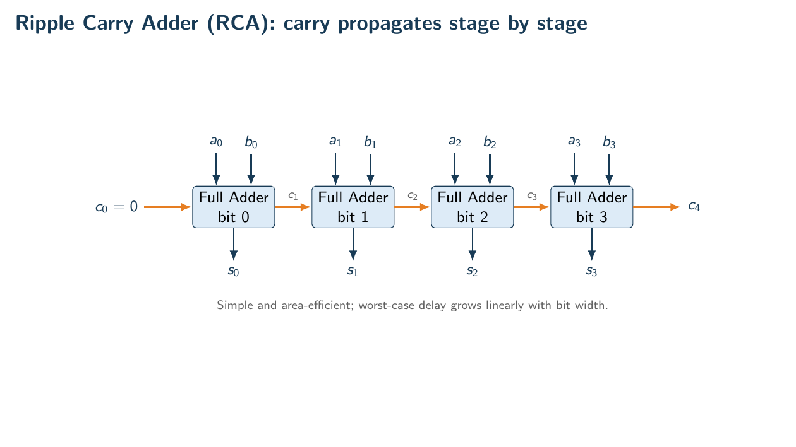
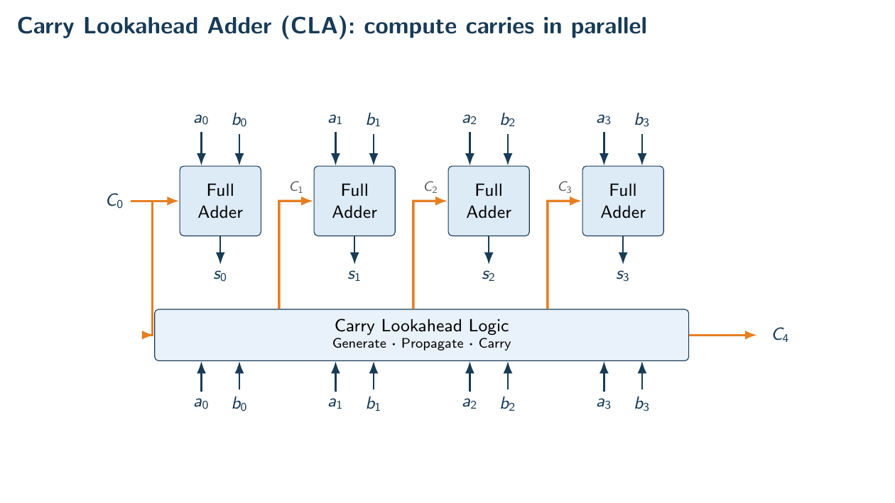
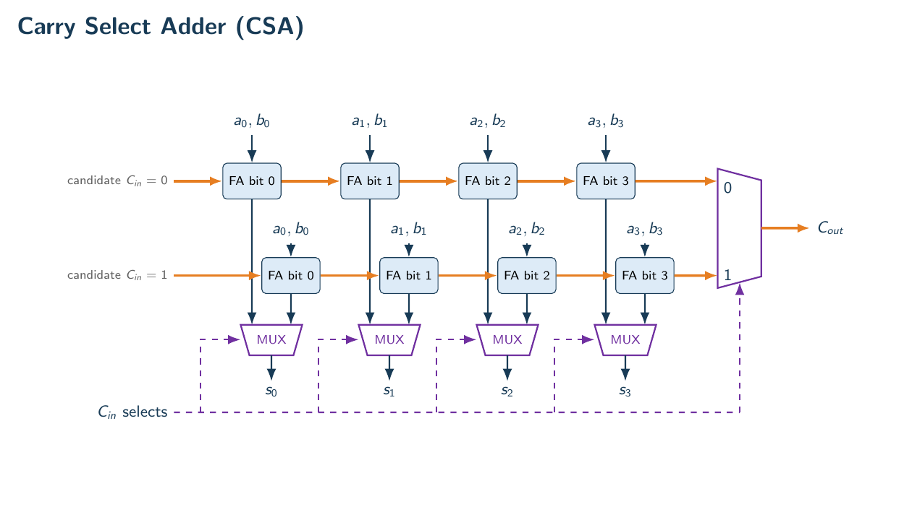
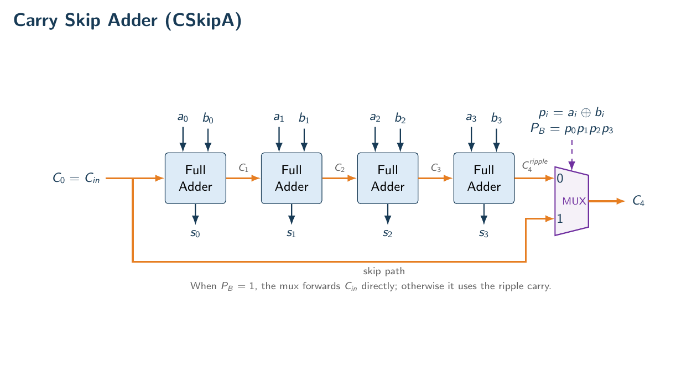
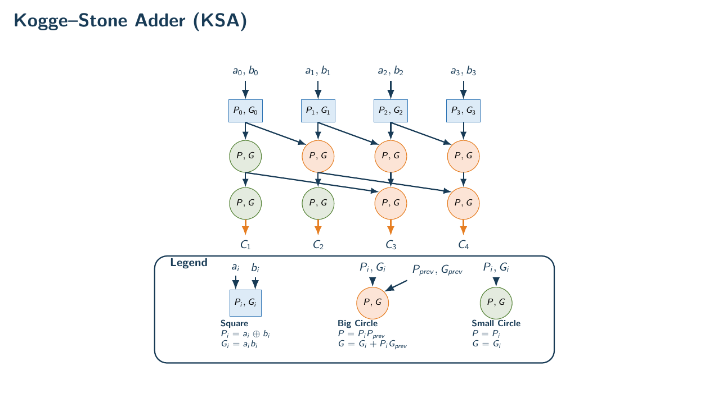
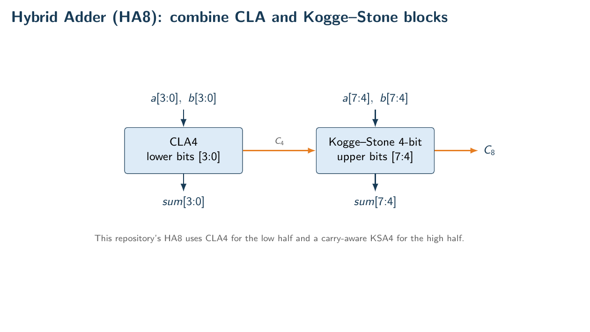

# Verilog Adders

Structural Verilog implementations of six adder architectures for studying how carry computation changes area, delay, and wiring complexity. The repository currently contains 4-bit and 8-bit designs, plus an 8-bit hybrid adder.

## Architecture overview

| Architecture | Carry strategy | Typical tradeoff | RTL in this repository |
|---|---|---|---|
| Ripple Carry (RCA) | Carry moves through every full-adder stage | Small and regular, but linear carry delay | 4-bit, 8-bit |
| Carry Lookahead (CLA) | Expanded generate/propagate equations form carries in parallel | Shorter carry path, with more logic and fan-in | 4-bit, 8-bit |
| Carry Select (CSA) | Candidate results for carry-in 0 and 1 are computed in parallel | Faster block selection, at the cost of duplicated hardware | 4-bit, 8-bit |
| Carry Skip (CSkipA) | A block-propagate condition bypasses the ripple path | Moderate area and delay between RCA and more aggressive schemes | 4-bit, 8-bit |
| Kogge--Stone (KSA) | A parallel-prefix tree combines generate/propagate pairs | Logarithmic prefix depth, with substantial wiring and node count | 4-bit, 8-bit |
| Hybrid (HA) | Different carry structures are used in different bit ranges | Lets a design target local timing/area goals | 8-bit |

These are educational, gate-level/structural implementations. Use synthesis and timing analysis—not the diagrams alone—to compare power, performance, and area in a target technology.

## Repository layout

```text
Carry Ripple Adder/       RCA4.v, RCA8.v
Carry Lookahead Adder/    CLA4.v, CLA8.v
Carry Select Adder/       CSA4.v, CSA8.v
Carry Skip Adder/         CSkipA4.v, CSkipA8.v
Kogge-Stone Adder/        KSA4.v, KSA8.v
Hybrid Adder/             HA8.v
docs/diagrams/            Generated architecture PDF and PNG figures
```

Every top-level module uses the same basic interface:

```verilog
module <NAME>(
    output [N-1:0] sum,
    output         cout,
    input  [N-1:0] a,
    input  [N-1:0] b
);
```

The repository's top-level adders assume an initial carry-in of zero. Internal helper modules may expose a carry-in port.

## Adder architectures

The course lecture slides use these same PNG files, so the README and slides
show the same diagrams.

### Ripple Carry Adder



An RCA chains full adders so that each stage consumes the previous stage's carry. Its layout is compact and easy to scale, but the worst-case carry path crosses all `N` stages.

Code: [RCA4.v](Carry%20Ripple%20Adder/RCA4.v) · [RCA8.v](Carry%20Ripple%20Adder/RCA8.v)

### Carry Lookahead Adder



The CLA first forms bit generate and propagate terms, `G_i = a_i & b_i` and `P_i = a_i ^ b_i`. It expands the carry recurrence so that multiple carries can be evaluated without waiting for a serial ripple chain.

Code: [CLA4.v](Carry%20Lookahead%20Adder/CLA4.v) · [CLA8.v](Carry%20Lookahead%20Adder/CLA8.v)

### Carry Select Adder



Each group computes two candidate sums: one for carry-in 0 and one for carry-in 1. When the real group carry arrives, multiplexers select the valid sum and carry. This reduces carry-dependent computation after the group boundary while duplicating arithmetic logic.

Code: [CSA4.v](Carry%20Select%20Adder/CSA4.v) · [CSA8.v](Carry%20Select%20Adder/CSA8.v)

### Carry Skip Adder



Within each group, the sum is produced by a ripple chain. If every bit in that group propagates carry, the block-propagate signal selects a bypass path and forwards the incoming carry directly to the next group.

Code: [CSkipA4.v](Carry%20Skip%20Adder/CSkipA4.v) · [CSkipA8.v](Carry%20Skip%20Adder/CSkipA8.v)

### Kogge--Stone Adder



The arrows show how generate/propagate pairs move through the prefix tree. The
legend defines all three operators: a Square creates `P_i,G_i` from `a_i,b_i`;
a Big Circle combines the current and previous `P,G` pairs; and a Small Circle
passes one `P,G` pair to the next row. The tree has few logic levels, but it
uses many wires and prefix nodes.

Code: [KSA4.v](Kogge-Stone%20Adder/KSA4.v) · [KSA8.v](Kogge-Stone%20Adder/KSA8.v)

### Hybrid Adder



The repository's `HA8` uses a CLA4 for bits `[3:0]`. Its carry-out drives the carry-in of a 4-bit Kogge--Stone block for bits `[7:4]`. The design demonstrates how carry architectures can be composed rather than applied uniformly across the full width.

Code: [HA8.v](Hybrid%20Adder/HA8.v)

## Scaling the designs

When extending an architecture to a larger bit width, preserve its carry strategy rather than only duplicating syntax:

- RCA: add full-adder stages and continue the carry chain.
- CLA: derive the larger generate/propagate carry equations, or introduce a hierarchy of lookahead groups.
- CSA: choose group sizes, build both carry assumptions per group, and connect the selection chain.
- Carry Skip: choose ripple-block sizes and compute a block-propagate signal for each bypass mux.
- KSA: add prefix levels at distances `1, 2, 4, ...` until the full width is covered.
- Hybrid: define the boundary between component architectures and connect the boundary carry explicitly.

For a generated design, verify both arithmetic correctness and architecture-specific structure. A correct `sum = a + b` behavioral description does not by itself demonstrate the intended carry network.

## Quick syntax check

With [Icarus Verilog](https://steveicarus.github.io/iverilog/) installed, a design can be elaborated directly:

```sh
iverilog -g2012 -Wall -s RCA8 -o /tmp/rca8.vvp "Carry Ripple Adder/RCA8.v"
```

Substitute another top-level name and source file to check a different implementation. Functional verification requires a testbench or another reference model.

## Diagram files

The compiled six-page version is available as
[adder_architectures.pdf](docs/diagrams/adder_architectures.pdf).

The six exported pages correspond, in order, to RCA, CLA, CSA, Carry Skip, Kogge--Stone, and Hybrid. The repository's named PNG files are these pages renamed for stable README links.

## License

Licensed under the [Apache License 2.0](LICENSE).
